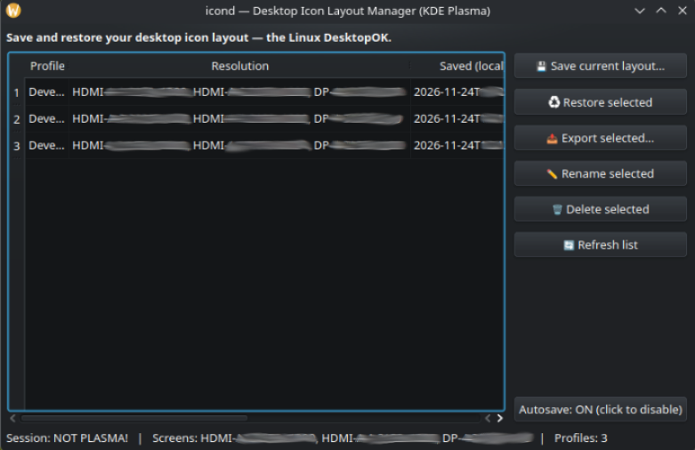
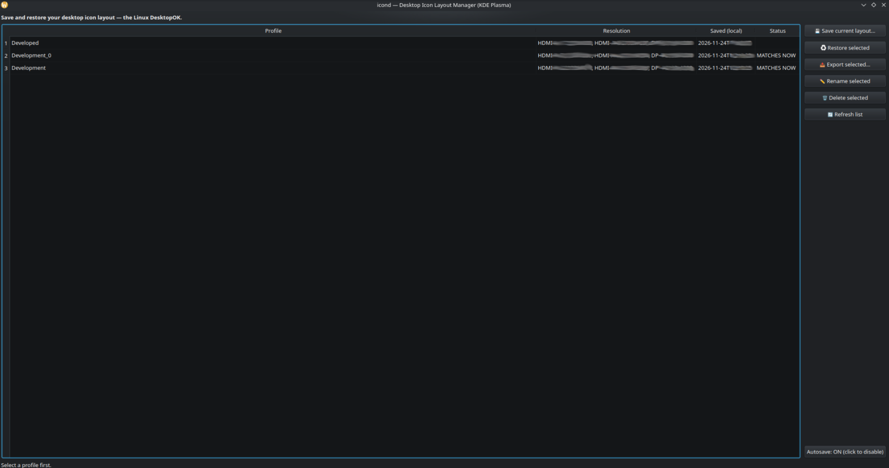
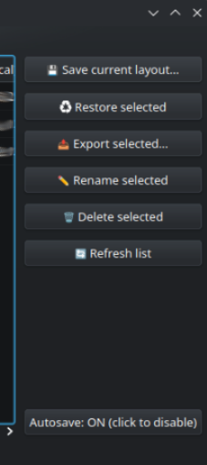

# icond — Desktop Icon Layout Manager for KDE Plasma

Save your desktop icon layout the way it's arranged on your desktop, and
restore it anytime — the Linux equivalent of the Windows program DesktopOK
(`desktopok.exe`), with its own GUI built for KDE Plasma.


 <br>
<table>
<tr>

 <br>
<sub>
 <br>
</sub>
 <h4>Full screen capability</h4> 
 <br>
</td>

 <br> 
<sub>
 <br>
 <i>✅ You can export your snapshots to a safe location, if your on a fresh installation.</i>
</sub>
 <h4> The PDUA Windowing Popup</h4>
 <br>
 <br>
 
<br><br>

## What it does

KDE Plasma stores the entire desktop layout — icon grid positions,
containments, Folder view settings, widget placement — in one config file:

```
~/.config/plasma-org.kde.plasma.desktop-appletsrc
```

icond snapshots that file into named profiles stored under
`~/.local/share/icond/profiles/*.kdl`, and restores them by swapping the
config back and restarting `plasmashell` (which briefly flickers the desktop,
just like DesktopOK applying a saved icon layout on Windows).

### Features

- **Save layout** — snapshot the current icon arrangement under any profile name
- **Restore layout** — put icons back exactly as they were; automatic safety
  backup of the layout you're replacing (10 rolling backups, never lose anything)
- **Export profile** — copy any saved profile to a portable `.kdl` file anywhere
  on disk (USB stick, another machine) via a native save dialog; the exported
  file carries the full layout data so it can be imported back in later
- **Resolution autosave** — when a monitor is plugged/unplugged or the screen
  resolution changes, icond silently saves an `auto-<timestamp>` profile first,
  so your layout is never scrambled and lost
- **Profile table** — name, resolution fingerprint, save time, and whether a
  profile matches your current screen setup
- Plasma-session detection (warns if you're not in KDE Plasma)

## Install & run

Requires: Python 3.9+ (uses Python 3.10+ `str | None` syntax at runtime,
developed and tested for Python 3.13 on KDE Neon), PySide6.

```bash
# from the repo root
python3 -m pip install --user PySide6

# run it
python3 main.py
```

### Menu launcher (optional)

```bash
# edit icond.desktop so Exec points at your real clone path, then:
mkdir -p ~/.local/share/applications
cp icond.desktop ~/.local/share/applications/
update-desktop-database ~/.local/share/applications 2>/dev/null || true
```

### Dependencies

- KDE Plasma session (5.x or 6.x, X11 or Wayland)
- `PySide6` (GUI + screen watcher)
- standard tools already on every KDE Neon box: `systemctl --user`,
  `pgrep`, `pkill`, `plasmashell`

## How restore works (and why the screen flickers)

1. icond stops `plasmashell` (via `systemctl --user` when available — the
   modern Plasma 6 way — otherwise `pkill`)
2. takes a timestamped safety backup of your current layout
3. atomically writes the chosen profile's config into place
4. starts `plasmashell` again — icons redraw at their saved positions

Stopping plasmashell first matters: plasmashell flushes its own copy of the
config when it exits, so writing the file while it runs would be overwritten.

## Files

```
icond/
├── main.py            # entrypoint
├── icond_gui.py       # PySide6 window + resolution-change autosave watcher
├── icond_profiles.py  # named .kdl profile store (~/.local/share/icond/profiles)
├── icond_backend.py   # appletsrc snapshot/restore + plasmashell control
├── icond.desktop      # menu launcher
└── README.md
```

## Caveats

- Restoring restarts plasmashell: any widgets' unsaved state (open popouts,
  unfinished clipboard-widget expansions) resets, but layouts restore fine.
- Restoring a layout saved under a different monitor setup may place icons
  off-screen if Plasma itself re-flows the folder view; keep per-resolution
  profiles and pick the matching one (the "MATCHES NOW" column helps).
- Backup files live beside the Plasma config as
  `plasma-org.kde.plasma.desktop-appletsrc.icond-YYYYMMDD-HHMMSS.bak`.

## Roadmap ideas

- System tray icon + background watcher daemon (watch config for drift)
- Per-resolution profile list with one-click "restore best match"
- Autostart option, CLI mode (`icond save` / `icond restore name`)
- GNOME / XFCE backend stubs if ever needed
